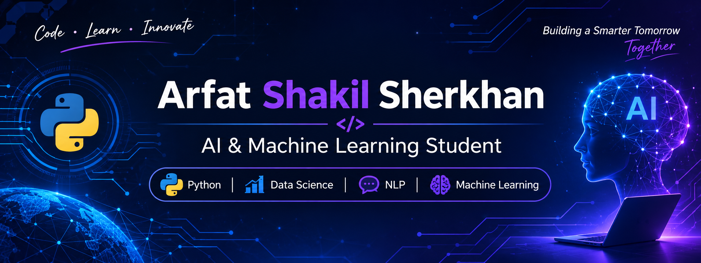

# Hi, I'm Arfat Shakil Sherkhan 👋

🎓 B.Tech Student in Artificial Intelligence & Machine Learning  
🏫 Sanjay Ghodawat University  
💻 Interested in Python, Data Science, Machine Learning, and NLP.

## 🚀 About Me
- I'm an AIML engineering student.
- Interested in solving real-world problems using AI and data.
- Currently improving my skills in Python, SQL, Machine Learning, and NLP.
- Enjoy building practical projects and learning new technologies.

## 🛠️ Technical Skills
- **Languages:** Python, SQL
- **Data Analysis:** Pandas, NumPy, Matplotlib, Seaborn
- **Machine Learning:** Scikit-learn, K-Means, LDA
- **NLP:** NLTK, Text Processing, Topic Modeling
- **Tools:** Git, GitHub, VS Code, Jupyter Notebook

## 📌 Featured Projects

### 1. Language Trends Analysis Using NLP
- Analyzed 209,497 news articles across 42 categories.
- Applied LDA Topic Modeling and K-Means Clustering.
- Created visualizations to understand language and topic trends.

🔗 [Week 4 NLP Project](https://github.com/arfatsherkhan786-a11y/Week4_Language_Trends_NLP)

## 📚 Currently Learning
- Advanced Python
- Data Science and Machine Learning
- Deep Learning
- AI and NLP Applications

## 🤝 Connect With Me
- GitHub: [@arfatsherkhan786-a11y](https://github.com/arfatsherkhan786-a11y)
- Email: arfatshakil786@gmail.com
- 
---
⭐ Thanks for visiting my GitHub profile!
## 📊 GitHub Statistics

## 🏆 GitHub Trophies

## 💻 Languages and Tools

